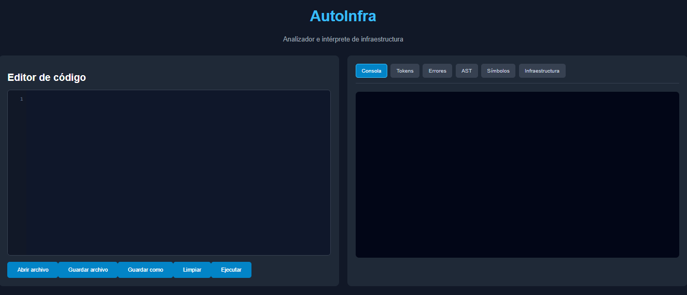
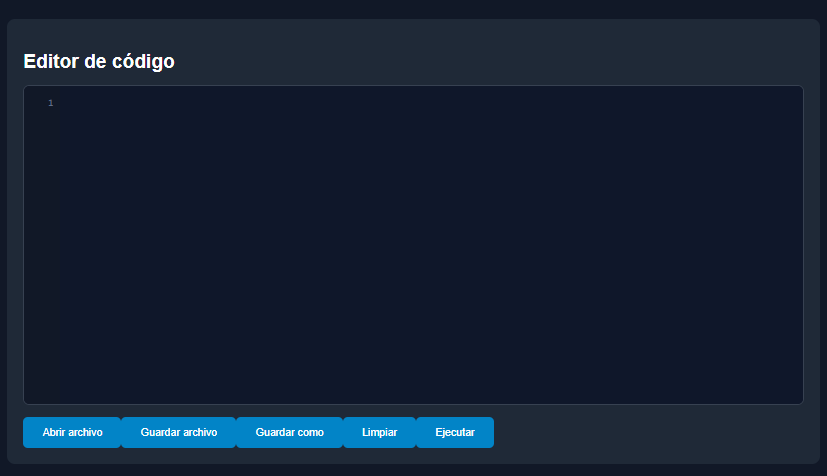
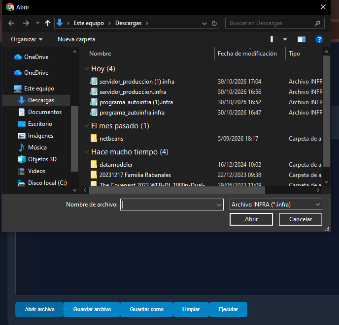
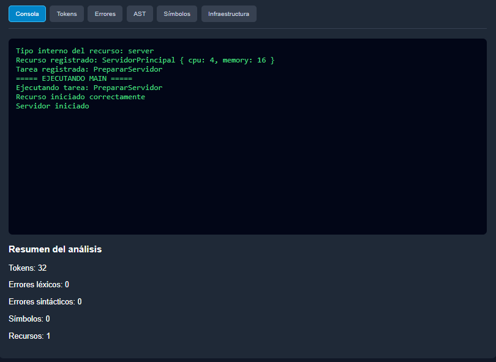
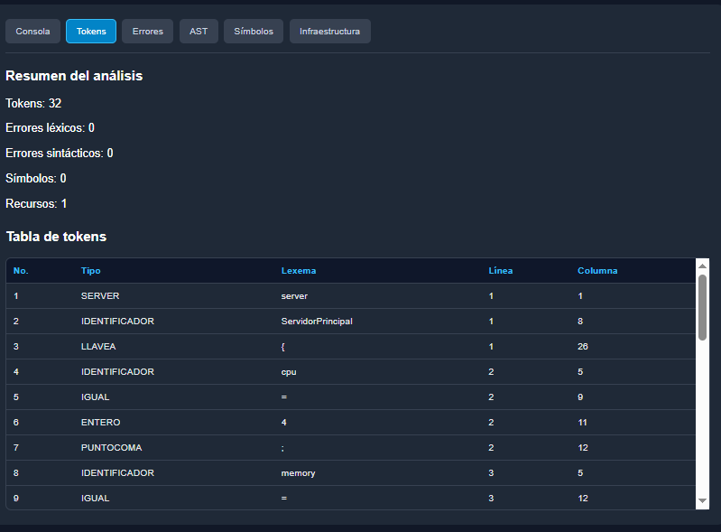
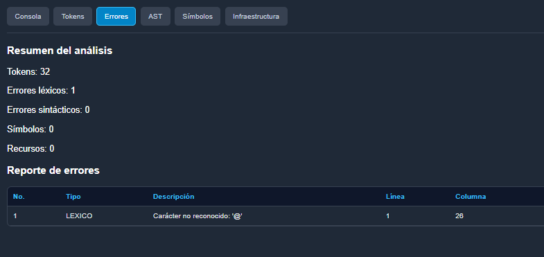
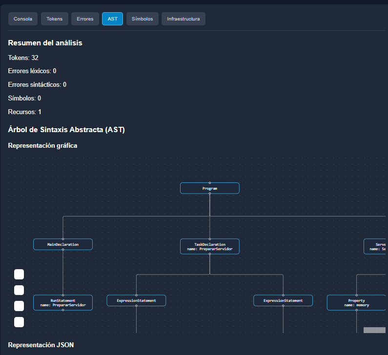
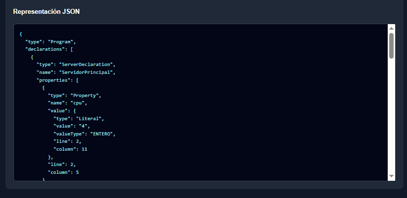
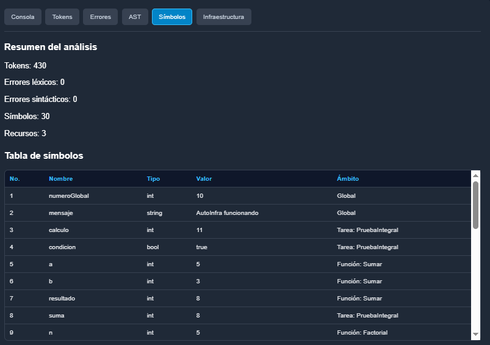
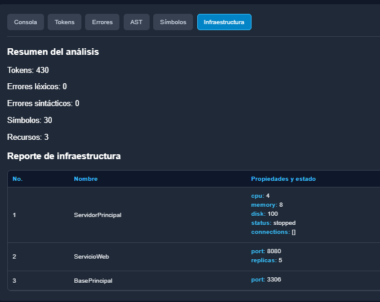

# Manual de Usuario – AutoInfra

**Universidad de San Carlos de Guatemala**  
**Facultad de Ingeniería**  
**Organización de Lenguajes y Compiladores 1**  
**Proyecto 2 – AutoInfra**

---

## 1. Introducción

AutoInfra es una aplicación web que permite escribir, analizar y ejecutar programas desarrollados en un lenguaje orientado a la administración de recursos de infraestructura tecnológica.

La aplicación cuenta con un editor de código en el que el usuario puede escribir instrucciones, abrir archivos existentes y guardar los cambios realizados.

Además, proporciona herramientas para ejecutar programas y consultar los resultados del análisis mediante diferentes reportes, como la lista de tokens, los errores encontrados, el Árbol de Sintaxis Abstracta (AST), la tabla de símbolos y los recursos de infraestructura registrados.

El presente manual tiene como objetivo explicar el funcionamiento de la aplicación y los pasos necesarios para utilizar sus principales herramientas.

## 2. Requisitos para utilizar la aplicación

Para utilizar AutoInfra de manera local se necesita:

- Un navegador web moderno, como Google Chrome o Microsoft Edge.
- Node.js y npm instalados.
- El código fuente completo del proyecto.
- El backend y el frontend ejecutándose correctamente.

La aplicación se utiliza desde el navegador, por lo que no requiere instalar un programa de escritorio adicional.

## 3. Inicio de la aplicación

### 3.1. Iniciar el backend

Abrir una terminal y acceder a la carpeta `backend` del proyecto.

Ejecutar:

    npm install

Posteriormente, iniciar el servidor mediante:

    node server.js

El backend utilizado durante el desarrollo se encuentra configurado para ejecutarse en:

    http://localhost:3000

### 3.2. Iniciar el frontend

Abrir una segunda terminal y acceder a la carpeta `frontend`.

Ejecutar:

    npm install

Después, iniciar la aplicación mediante:

    npm run dev

Una vez iniciado el servidor de desarrollo, abrir en el navegador la dirección:

    http://localhost:5173

Si Vite muestra una dirección diferente en la terminal, utilizar la dirección indicada.

### 3.3. Pantalla principal

Al ingresar a la aplicación, se presenta la interfaz principal de AutoInfra.

Esta pantalla contiene el editor de código, las opciones para administrar archivos, el botón de ejecución y las pestañas utilizadas para visualizar los resultados.

**Figura 1.** Pantalla principal de la aplicación AutoInfra.

## 4. Editor de código

### 4.1. Descripción del editor

El editor de código es el espacio donde el usuario puede escribir las instrucciones del lenguaje AutoInfra.

El editor incluye numeración de líneas, lo que facilita identificar la ubicación de las instrucciones y localizar posibles errores.

### 4.2. Escribir un programa

Para escribir un programa:

1. Ubicarse en el editor de código.
2. Escribir las instrucciones utilizando la sintaxis de AutoInfra.
3. Verificar que las declaraciones y los bloques estén correctamente estructurados.
4. Seleccionar la opción de ejecución cuando el programa esté listo.

Ejemplo:

    server ServidorPrincipal {
        cpu = 4;
        memory = 8;
        disk = 100;
    }

    task IniciarServidor {
        start(ServidorPrincipal);
        print(status(ServidorPrincipal));
    }

    main {
        run IniciarServidor;
    }

Este programa declara un servidor, crea una tarea y ejecuta instrucciones para iniciar el recurso y consultar su estado.

**Figura 2.** Editor con un programa escrito en AutoInfra.

## 5. Administración de archivos

### 5.1. Abrir un archivo

La opción **Abrir** permite cargar un archivo de código fuente desde el equipo.

Para utilizarla:

1. Seleccionar el botón **Abrir**.
2. Buscar el archivo que se desea cargar.
3. Seleccionar el archivo correspondiente.
4. Confirmar la selección.

El contenido del archivo se mostrará en el editor.

**Figura 3.** Carga de un archivo de código fuente.

### 5.2. Guardar un archivo

La opción **Guardar** permite almacenar el contenido del editor en un archivo.

Para guardar un programa:

1. Escribir o modificar el código fuente.
2. Seleccionar el botón **Guardar**.
3. Completar el proceso de almacenamiento que presente el navegador.

Se recomienda utilizar la extensión `.infra` para identificar los programas de AutoInfra.

### 5.3. Guardar como

La opción **Guardar como** permite guardar el contenido del editor utilizando un nombre de archivo diferente.

Esta opción resulta útil cuando se desea conservar una versión anterior del programa y crear una copia con modificaciones.

### 5.4. Limpiar el editor

La opción **Limpiar** elimina el contenido actual del editor.

Para utilizarla:

1. Seleccionar el botón **Limpiar**.
2. Verificar que el editor haya quedado vacío.
3. Escribir o cargar un nuevo programa.

Se recomienda guardar el código antes de limpiar el editor si se desea conservar su contenido.

## 6. Ejecución de programas

### 6.1. Ejecutar código fuente

Para ejecutar un programa:

1. Escribir o cargar el código fuente.
2. Seleccionar el botón **Ejecutar**.
3. Esperar a que finalice el análisis.
4. Revisar los resultados mostrados en la aplicación.

Durante este proceso, el código es enviado al backend, donde se realiza el análisis léxico, sintáctico y la interpretación de las instrucciones.

### 6.2. Consola de resultados

La pestaña **Consola** permite visualizar los mensajes producidos durante la ejecución.

Entre los resultados que pueden aparecer se encuentran:

- Valores mostrados mediante `print()`.
- Mensajes de ejecución de tareas.
- Resultados de funciones.
- Información relacionada con recursos de infraestructura.

**Figura 4.** Resultados de ejecución mostrados en la consola.

## 7. Reporte de tokens

La pestaña **Tokens** muestra los elementos reconocidos por el analizador léxico.

Este reporte permite consultar las palabras reservadas, identificadores, operadores, valores literales y símbolos presentes en el programa.

La tabla presenta información como:

- Tipo de token.
- Lexema reconocido.
- Línea.
- Columna.

Para consultar el reporte:

1. Ejecutar un programa.
2. Seleccionar la pestaña **Tokens**.
3. Revisar la tabla generada.

**Figura 5.** Reporte de tokens reconocidos.

## 8. Reporte de errores

La pestaña **Errores** muestra los problemas detectados durante el análisis del código fuente.

La aplicación permite identificar errores léxicos y sintácticos.

Entre los errores que pueden aparecer se encuentran:

- Caracteres no reconocidos.
- Cadenas sin cerrar.
- Secuencias de escape incorrectas.
- Puntos y coma faltantes.
- Llaves o paréntesis sin cerrar.
- Instrucciones con estructura incorrecta.

### 8.1. Consultar errores

Para consultar los errores:

1. Ejecutar el código fuente.
2. Seleccionar la pestaña **Errores**.
3. Revisar la descripción del error.
4. Identificar la línea y columna correspondientes.
5. Corregir el código y ejecutarlo nuevamente.

Ejemplo de código con error:

    int numero = 10

En este caso, falta el punto y coma al final de la declaración.

**Figura 6.** Reporte de errores léxicos y sintácticos.

## 9. Árbol de Sintaxis Abstracta (AST)

La pestaña **AST** permite visualizar la estructura sintáctica del programa.

El AST representa las instrucciones mediante nodos organizados jerárquicamente.

La aplicación cuenta con una representación gráfica y una representación en formato JSON.

### 9.1. Visualización gráfica

La vista gráfica permite observar los nodos y las conexiones entre las diferentes instrucciones del programa.

Para utilizarla:

1. Ejecutar un programa válido.
2. Seleccionar la pestaña **AST**.
3. Consultar la representación gráfica generada.
4. Explorar los nodos para identificar las declaraciones y expresiones.

**Figura 7.** Representación gráfica del AST.

### 9.2. Visualización JSON

La vista JSON permite consultar la estructura interna del AST.

En esta representación se muestran los tipos de nodos y sus atributos, facilitando la comprensión de la organización del programa.

**Figura 8.** Representación del AST en formato JSON.

## 10. Tabla de símbolos

La pestaña **Símbolos** permite consultar las variables y parámetros registrados durante la ejecución.

Este reporte contiene información como:

- Nombre del símbolo.
- Tipo de dato.
- Valor.
- Ámbito.

Los ámbitos permiten distinguir las variables globales de las variables locales utilizadas en tareas y funciones.

Para consultar el reporte:

1. Ejecutar un programa que contenga variables.
2. Seleccionar la pestaña **Símbolos**.
3. Revisar los registros mostrados.

**Figura 9.** Tabla de símbolos generada durante la ejecución.

## 11. Reporte de infraestructura

La pestaña **Infraestructura** permite visualizar los recursos declarados durante la ejecución del programa.

Entre los recursos admitidos se encuentran:

- Servidores.
- Servicios.
- Bases de datos.

El reporte presenta información sobre las propiedades de los recursos y su estado.

También permite observar los cambios realizados mediante funciones nativas, como iniciar o detener recursos, modificar réplicas y administrar conexiones.

### 11.1. Consultar recursos

Para consultar el reporte:

1. Escribir o cargar un programa que declare recursos.
2. Ejecutar el programa.
3. Seleccionar la pestaña **Infraestructura**.
4. Revisar los recursos registrados y sus propiedades.

**Figura 10.** Recursos de infraestructura registrados.

## 12. Ejemplo completo de utilización

En esta sección se presenta un ejemplo del uso de AutoInfra.

### 12.1. Preparar el código fuente

Abrir la aplicación y escribir el siguiente programa:

    server ServidorPrincipal {
        cpu = 4;
        memory = 8;
        disk = 100;
    }

    service ServicioWeb {
        port = 8080;
        replicas = 2;
    }

    task ConfigurarInfraestructura {
        print("Iniciando configuración");
        start(ServidorPrincipal);
        scale(ServicioWeb, 3);
        print(status(ServidorPrincipal));
    }

    main {
        run ConfigurarInfraestructura;
    }

### 12.2. Ejecutar el programa

Seleccionar el botón **Ejecutar** para iniciar el análisis y la interpretación.

### 12.3. Revisar la consola

Consultar los mensajes generados durante la ejecución de la tarea `ConfigurarInfraestructura`.

### 12.4. Consultar los reportes

Revisar las pestañas **Tokens**, **Errores**, **AST**, **Símbolos** e **Infraestructura** para observar los resultados del procesamiento.

### 12.5. Guardar el programa

Utilizar la opción **Guardar como** y almacenar el archivo con el nombre:

    ejemplo_infraestructura.infra

## 13. Recomendaciones de uso

Para utilizar correctamente la aplicación se recomienda:

- Verificar que el backend y el frontend estén ejecutándose.
- Utilizar la extensión `.infra` para los archivos del lenguaje.
- Revisar los errores después de ejecutar un programa.
- Guardar los cambios realizados en el editor.
- Consultar el AST para comprender la estructura de las instrucciones.
- Utilizar la tabla de símbolos para revisar variables y ámbitos.
- Consultar el reporte de infraestructura para verificar los recursos registrados.

## 14. Conclusiones

AutoInfra proporciona una interfaz web que facilita la escritura, análisis y ejecución de programas desarrollados en su propio lenguaje.

Las opciones de administración de archivos permiten trabajar con programas guardados y realizar modificaciones desde el editor.

Los reportes de tokens, errores, AST, tabla de símbolos e infraestructura permiten consultar los resultados del análisis y comprender el funcionamiento de las instrucciones ejecutadas.

De esta manera, la aplicación reúne las herramientas necesarias para utilizar y verificar las principales funcionalidades del lenguaje AutoInfra.
